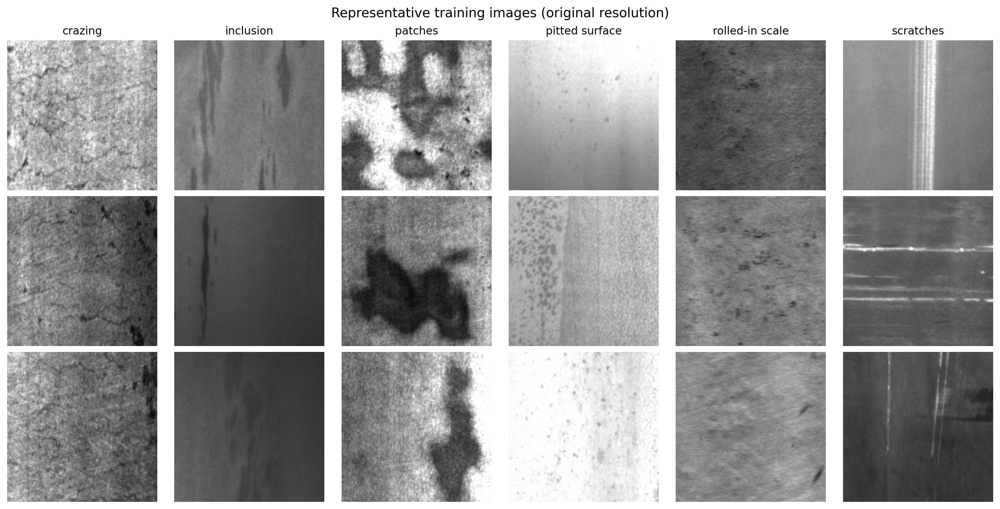
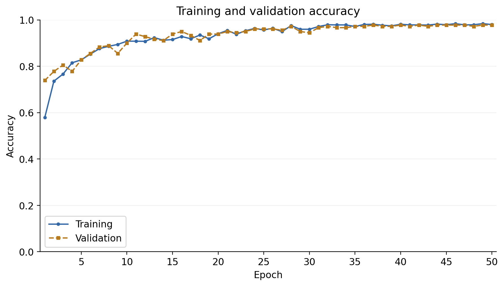
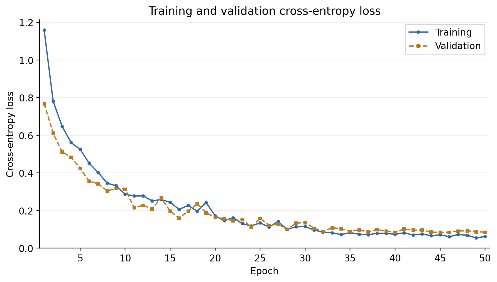
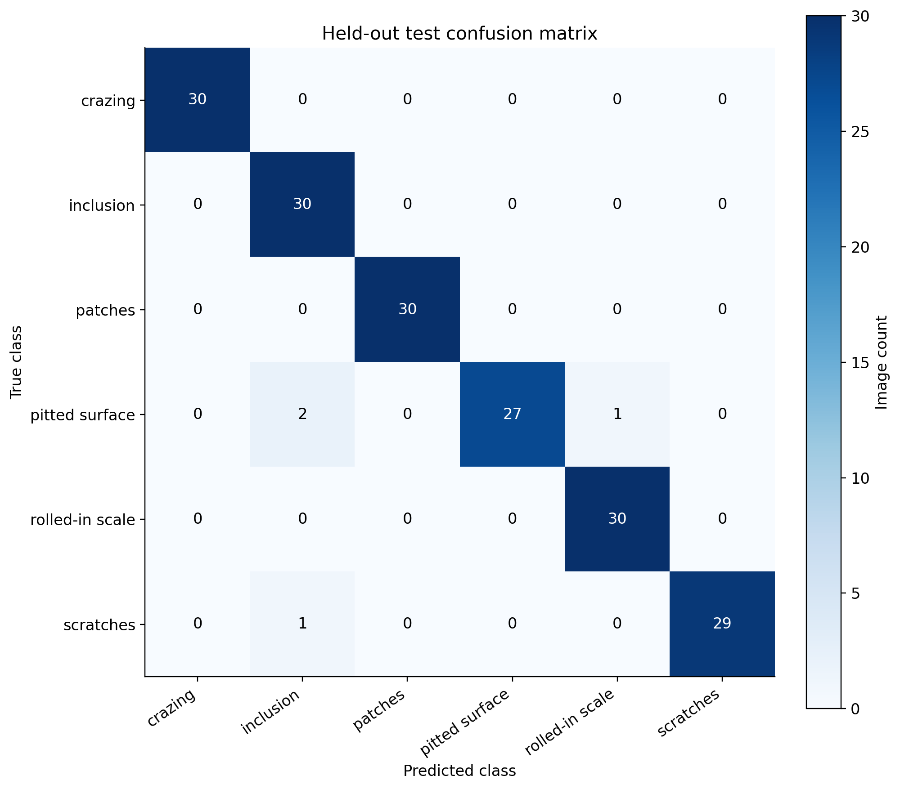

# CNN-Based Automated Steel Surface Defect Classification for Industrial Quality Inspection

**UCS321 university mini-project · Final held-out test accuracy: 97.78%**

## Overview

Steel surface defects affect product quality and require consistent inspection.
This project investigates automated classification of cropped surface images into
six defect categories using a compact custom convolutional neural network (CNN).
It is an academic benchmark motivated by industrial steel inspection. It does not
claim deployment at any company or localization of defects on full steel plates.

The ML experiment is complete. The selected model and final results are committed
in [outputs/final](outputs/final). Prediction and the demo load this model without
training or recalibration.

## Dataset

The [NEU Surface Defect Database](https://faculty.neu.edu.cn/songkc/en/zdylm/263265/list/index.htm)
contains 200 × 200 grayscale defect images. This experiment uses the checksum-pinned
[NEU-CLS Figshare mirror, version 1](https://doi.org/10.6084/m9.figshare.28903550.v1).
Its detection annotations are unused; classification labels come from filenames.

| Label | Class | Typical pattern |
| ---: | --- | --- |
| 0 | `crazing` | Crack-like networks |
| 1 | `inclusion` | Inclusion patterns |
| 2 | `patches` | Irregular patches |
| 3 | `pitted_surface` | Pits and rough texture |
| 4 | `rolled-in_scale` | Rolled-in scale patterns |
| 5 | `scratches` | Elongated scratch marks |

Of **1,800 original images**, one exact decoded-pixel duplicate was explicitly
excluded, leaving **1,799 unique usable images**. Source packaging boundaries were
discarded before the deterministic stratified **80/10/10 split, seed 42**:

| Partition | Images | Per-class counts |
| --- | ---: | --- |
| Training | 1,439 | 240 each; patches 239 |
| Validation | 180 | 30 each |
| Test | 180 | 30 each |

The frozen [manifest](outputs/final/metrics/manifest.csv) records relative paths,
labels, pixel hashes and partitions. Images and archives are downloaded separately
and excluded from Git. See [dataset provenance and setup](data/README.md) for the
archive checksum, duplicate exclusion and citation.

## Preprocessing

Images are converted to grayscale, resized bilinearly to **128 × 128**, and supplied
as float32 pixels. The saved model rescales pixels from 0–255 to 0–1.
Training-only augmentation applies horizontal/vertical flips, rotation up to ±9°,
translation up to 5%, and zoom up to 5%, with reflected borders. Validation, test
and prediction use no augmentation. Duplicate exclusion precedes splitting;
the frozen manifest is reused throughout the experiment.

## Architecture

```text
128 × 128 × 1 input
→ Rescaling(1/255)
→ Training-only augmentation
→ Conv2D(32, 3×3) → BatchNorm → ReLU → MaxPool
→ Conv2D(64, 3×3) → BatchNorm → ReLU → MaxPool
→ Conv2D(128, 3×3) → BatchNorm → ReLU
→ GlobalAveragePooling
→ Dense(64, ReLU) → Dropout(0.3)
→ Dense(6, Softmax)
```

**Total model parameters: 101,990** (101,542 trainable; 448 BN statistics).
Convolutions learn local surface patterns. Batch normalization (BN) normalizes
intermediate activations; ReLU introduces nonlinearity. Max pooling reduces spatial
resolution. Global average pooling keeps the classifier compact, while dropout
limits reliance on individual features. Softmax produces six class scores.
See the [saved architecture summary](outputs/final/models/architecture.txt).

## Training methodology

Training uses only the training split, with Adam, sparse categorical cross-entropy,
batch size 32 and initial learning rate 0.001. Seed 42 and TensorFlow deterministic
operations are enabled. **Validation loss alone** controls checkpoint selection,
early stopping (patience 8), and learning-rate reduction (factor 0.5 after 3 plateau
epochs, minimum `1e-6`). The final run completed 50 epochs and selected **epoch 45**.

An earlier development run exposed unreliable BN moving statistics in this
small-batch regime. The correction refreshes BN inference population moments from
**unaugmented training images only**, before each validation pass. Layers are
calibrated in order with sample-weighted moments; augmentation and dropout are
disabled, and learned weights are unchanged by calibration. Validation and test
images never compute these statistics. The saved checkpoint contains the calibrated
moments. The [validation failure audit](docs/validation-failure-audit.md) preserves
the diagnosis and correction.

Before test evaluation, the selected checkpoint was independently reloaded and
reproduced validation accuracy **97.7778% (176/180)** and loss **0.0841048211**.
The held-out test set was evaluated only after model selection and checkpoint
verification. It did not control fitting or model selection.

## Final held-out test results

| Metric | Final value |
| --- | ---: |
| Accuracy | **97.78%** |
| Macro precision | **97.95%** |
| Macro recall | **97.78%** |
| Macro F1 | **97.77%** |
| Weighted F1 | **97.77%** |
| Test cross entropy | **0.0603** |
| Test samples | **180** |
| Selected epoch | **45** |

The model classified **176 of 180** test images correctly. Macro metrics give each
class equal weight; weighted F1 weights each class by its support. Full precision
is retained in [test_metrics.json](outputs/final/metrics/test_metrics.json), with
the [classification report](outputs/final/metrics/classification_report.txt) and
[per-image predictions](outputs/final/metrics/test_predictions.csv).

## Figures

Training examples (EDA uses training images only):



| Training accuracy | Training loss |
| --- | --- |
|  |  |

Confusion matrix: rows are true classes; columns are predicted classes.



Additional figures: [split distribution](outputs/final/figures/split_distribution.png),
[class distribution](outputs/final/figures/class_distribution.png),
[normalized confusion matrix](outputs/final/figures/confusion_matrix_normalized.png),
[test prediction examples](outputs/final/figures/test_predictions.png), and
[demo output](outputs/final/figures/demo.png).

## Usage

Run commands from the repository root in **Windows PowerShell**.

### Environment setup

Use **Python 3.12** (final run: 3.12.8). The package restricts installation to 3.12.
The tested setup uses `uv`, which is available in the project environment and
manages the Python environment and dependency installation.

```powershell
uv venv --python 3.12 .venv
uv pip install --python .venv/Scripts/python.exe -r requirements.txt
uv pip install --python .venv/Scripts/python.exe --no-deps -e .
.venv\Scripts\Activate.ps1
```

If activation is disabled, use `.venv\Scripts\python.exe` instead of `python`.
The editable installation makes `steel_defect` available to scripts.
If Python 3.12 is already installed through the Windows launcher, a standard
alternative is `py -3.12 -m venv .venv`, followed by activation,
`python -m pip install -r requirements.txt` and `python -m pip install --no-deps -e .`.

### Use the already-trained final model

Prediction accepts any image path. To obtain the example image from the pinned
mirror and validate the committed frozen manifest:

```powershell
python scripts/prepare_data.py --download --deduplicate --manifest outputs/final/metrics/manifest.csv
python -m steel_defect.predict data/raw/NEU-CLS/train/train/images/crazing_10.jpg --model outputs/final/models/best.keras
python demo.py data/raw/NEU-CLS/train/train/images/crazing_10.jpg --model outputs/final/models/best.keras
```

To save a demo without opening a window:

```powershell
python demo.py data/raw/NEU-CLS/train/train/images/crazing_10.jpg --model outputs/final/models/best.keras --save outputs/demo/demo.png --no-show
```

No dataset download is needed when predicting your own image. Source `train/valid`
folders do not determine final partition membership. The example is a demonstration,
not another evaluation score. Confidence is a softmax score, not a calibrated
probability of correctness.

### Reproduce the complete experiment

These commands are for a future independent reproduction. **The final experiment
is complete; no rerun is needed for submission.** Reuse the committed manifest,
write to a new run directory, and keep the published artifacts unchanged.

```powershell
python scripts/prepare_data.py --download --deduplicate --manifest outputs/final/metrics/manifest.csv
python scripts/run_eda.py --manifest outputs/final/metrics/manifest.csv --output-dir outputs/reproduction
python -m steel_defect.train --manifest outputs/final/metrics/manifest.csv --run-dir outputs/reproduction
python -m steel_defect.evaluate --run-dir outputs/reproduction --data-dir data/raw/NEU-CLS
```

Run evaluation only after that reproduction's model selection and checkpoint
verification. Training refuses to overwrite an existing run. `--help` lists CLI
options. Every model command above explicitly selects its intended model/run;
the legacy CLI default output directory is `outputs`.

### Check the code

```powershell
python -m unittest discover -s tests -v
python -m compileall -q src scripts tests demo.py
uv pip check --python .venv/Scripts/python.exe
```

Tests use synthetic images and temporary models. They do not retrain the final
model or evaluate its held-out test set.

## Project structure

```text
.
├── README.md
├── requirements.txt / pyproject.toml
├── data/README.md                  # provenance; raw images stay local
├── src/steel_defect/               # data, model, BN calibration, train/evaluate/predict
├── scripts/prepare_data.py         # download, integrity checks, frozen manifest
├── scripts/run_eda.py              # dataset figures
├── tests/                         # data integrity and pipeline tests
├── docs/validation-failure-audit.md # engineering history
├── docs/reproducibility.md         # artifact integrity and verification record
├── outputs/final/                 # curated final model, metrics and figures
└── demo.py                        # image and class-score display
```

## Reproducibility

Direct dependencies are pinned in [requirements.txt](requirements.txt) and reused
by `pyproject.toml`. The final [environment metadata](outputs/final/metrics/environment.json)
records Python, package versions and CPU device. The [run configuration](outputs/final/metrics/run_config.json)
records training settings, split counts and calibration policy.

- Model SHA-256: `24e83202be8281c790e606ff7d29856cc7985d7f07398e81cfe630af38549a5d`
- Manifest SHA-256: `a3e658e5cdebcb3b5b9d5ddf6399b626f612367c56dd1bbf5d2f9f1c42690a75`

Verify on PowerShell with `Get-FileHash outputs/final/models/best.keras -Algorithm SHA256`
and `Get-FileHash outputs/final/metrics/manifest.csv -Algorithm SHA256`.
Fixed seeds improve repeatability; hardware and framework differences can still
affect a fresh training run. The committed checkpoint preserves the final model.

## Limitations

This is a small academic dataset of controlled image crops. It contains six known
defect categories and no healthy-steel class. The classifier cannot certify a plate
as defect-free or localize defects. Exact deduplication does not rule out related
images or shared production batches. Real industrial use would require broader
domain data, camera/lighting robustness tests and external validation.

## Author / Course

- Author: **[Student name]**
- Enrollment number: **[Enrollment number]**
- Course: **UCS321**
- Institution: **[Institution name]**
