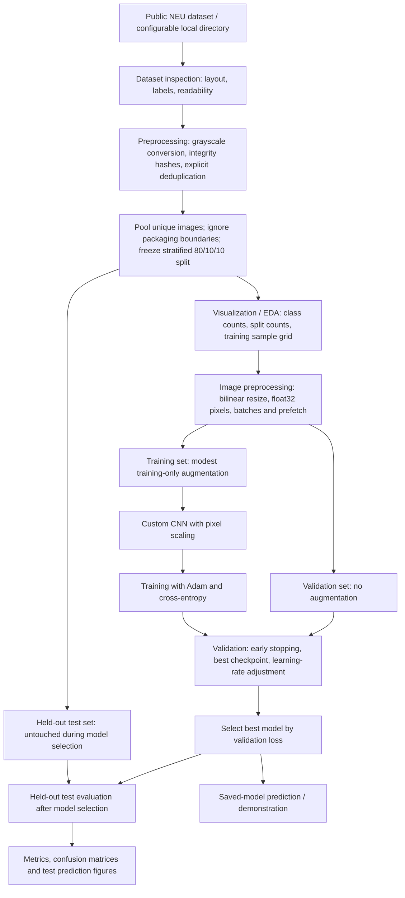

# Steel Surface Defect Classification with a Custom CNN

**UCS321 AI Mini Project · Second-year engineering**

A reproducible TensorFlow/Keras project that classifies cropped steel surface
images into six defect categories using an understandable custom convolutional
neural network (CNN). It includes dataset inspection, preprocessing, visualization,
training, held-out evaluation, single-image inference and a lightweight demo.

## Problem statement and industrial motivation

Tata Steel Ltd. is automating quality inspection in its manufacturing process.
The project explores how a CNN can identify cracks and other surface defects
from steel images, supporting consistent inspection and reducing missed defects.

The implementation is an academic **image-classification baseline** on NEU
surface crops. It is not a Tata Steel deployment or a system for locating defects
in full-resolution plates. The dataset contains defective surfaces only; there
is no healthy-steel class, so the model cannot decide whether an arbitrary plate
is defect-free. “Crazing” represents crack-like surface patterns in this benchmark.

## Current result status

No final 128 × 128 academic training run has been completed. No final accuracy
is claimed. The previous one-epoch, 32 × 32 integration smoke run used a
superseded split. Its artifacts in `outputs/smoke/` are marked as non-final
development artifacts, and its manifest is invalidated. Run fresh training and
held-out evaluation with the final 80/10/10 manifest below
before preparing the university report or PPT.

## Dataset and provenance

The [official NEU Surface Defect Database](https://faculty.neu.edu.cn/songkc/en/zdylm/263265/list/index.htm),
created by Kechen Song and Yunhui Yan at Northeastern University, describes
1,800 grayscale images at 200 × 200 pixels, with 300 images per class:

| Integer label | Class | Surface pattern |
| ---: | --- | --- |
| 0 | `crazing` | Crack-like networks |
| 1 | `inclusion` | Embedded foreign-material patterns |
| 2 | `patches` | Irregular patches |
| 3 | `pitted_surface` | Small pits and rough texture |
| 4 | `rolled-in_scale` | Rolled-in oxide scale patterns |
| 5 | `scratches` | Elongated scratch marks |

The automatic route uses a checksum-pinned [Figshare mirror, version 1](https://doi.org/10.6084/m9.figshare.28903550.v1).
Inspection found JPEG images with detection annotations and a 1,770/30
train/validation split, rather than a simple original NEU-CLS class-folder archive.
The classifier uses filename labels. One exact same-class duplicate is excluded
with an explicit `--deduplicate` option. The packaging was inspected but its
train/valid boundary is **not retained** for final classification: its 30-image
validation set (five per class) is unsuitable for reliable early stopping,
checkpoint selection and learning-rate decisions. It is not a classification
benchmark split that this project is required to preserve.

All **1,799 unique images** are pooled before creating a deterministic,
class-stratified **80% / 10% / 10%** train/validation/test split with seed 42.

| Frozen partition | Image count | Per-class counts |
| --- | ---: | --- |
| Training | 1,439 | 240 each; patches 239 |
| Validation | 180 | 30 each |
| Test | 180 | 30 each |
| **Distinct total** | **1,799** | **300 each; patches 299** |

These verified counts apply to the pinned mirror, not every NEU distribution.
The original official NEU-CLS archive is also supported through manual extraction and an explicit
`--data-dir`. See [data/README.md](data/README.md) for exact source links,
checksum, inspected layout, deduplication policy, citation and alternative commands.

## Project workflow



Deterministic pixel conversion and integrity checks require no learned statistics.
No normalization parameters are fitted on the whole dataset. Actual augmentation
runs inside the model during training; validation and test calls disable it.

## Repository structure

```text
.
├── README.md
├── requirements.txt                 # pinned direct dependencies
├── pyproject.toml                   # editable package installation
├── data/README.md                   # source and local dataset instructions
├── src/steel_defect/
│   ├── config.py                    # defaults and class order
│   ├── data.py                      # inspection, splits and shared image pipeline
│   ├── model.py                     # custom CNN
│   ├── train.py                     # training and saved run information
│   ├── evaluate.py                  # held-out evaluation
│   ├── predict.py                   # saved-model inference
│   ├── visualize.py                 # academic figures
│   └── utils.py                     # JSON and expected CLI errors
├── scripts/prepare_data.py          # optional download and frozen manifest
├── scripts/run_eda.py               # EDA figures
├── tests/                           # integrity and pipeline tests
├── docs/implementation-plan.md
├── outputs/README.md                # generated artifact guide
└── demo.py                          # matplotlib demonstration
```

## Installation

Use **Python 3.12**. The package intentionally restricts Python to 3.12 because
this is the tested interpreter and dependency combination. TensorFlow 2.20 has
[Python 3.12 wheels](https://pypi.org/project/tensorflow/2.20.0/).
Dependencies are TensorFlow/Keras, NumPy, scikit-learn, matplotlib and Pillow
(for consistent grayscale decoding of BMP/JPEG/PNG/TIFF). pandas is unnecessary.

From the repository root on Windows PowerShell:

```powershell
py -3.12 -m venv .venv
.venv\Scripts\Activate.ps1
python -m pip install -r requirements.txt
python -m pip install --no-deps -e .
```

If activation is disabled by your PowerShell policy, use
`.venv\Scripts\python.exe` in place of `python` in every command.
On Linux/macOS, create the environment with `python3.12 -m venv .venv`, then
activate with `source .venv/bin/activate` and use the same pip commands.
The editable install is required so that `steel_defect` imports work from scripts.

The Windows TensorFlow package runs on CPU; modern GPU support on Windows
requires WSL2. See the [official TensorFlow installation guide](https://www.tensorflow.org/install/pip).
CPU training is sufficient for this mini-project. TensorFlow is a large download.

## Reproduce the complete project

Run commands from the repository root using the environment's interpreter.

### 1. Obtain, inspect and split the dataset

```powershell
python scripts/prepare_data.py --download --deduplicate
```

This verifies archive size and MD5, extracts into `data/raw/NEU-CLS`, validates
every image, detects identical grayscale pixels, resolves labels, and creates
`data/processed/manifest.csv` plus a JSON inspection summary. Each manifest row
contains relative path, class, integer label, original dimensions, pixel SHA-256,
partition and split-method version. A subsequent preparation command revalidates and reuses the
existing manifest. It does not silently redraw splits or apply new split flags.

The final protocol pools every unique image regardless of its source folder.
Defaults are stratified 80% / 10% / 10%, seed 42 (`--seed` is configurable).
Each held-out partition targets `round(0.10 × distinct_image_count)` images;
stratification apportions these counts by class, and training receives the remainder.
For this mirror, both held-out partitions have exactly 30 images per class.
The single image shortfall in patches stays in training, the closest possible balance.
The final held-out test set never controls augmentation, fitting, early stopping,
checkpoint selection, learning-rate decisions or hyperparameter tuning.
Exact duplicates cannot cross splits. Related production batches cannot be grouped
because the source does not supply batch identifiers; this remains a limitation.

Manifests from the previous packaging-based methodology are rejected by all
manifest readers. They have been archived as `manifest.invalid.csv` / `.json`,
including the previous smoke run's CSV, and cannot be reused as final partitions.
To deliberately replace another obsolete manifest, use
`python scripts/prepare_data.py --deduplicate --regenerate`. This archives it
before creating a new one; it refuses to overwrite an existing invalidated archive.
After freezing the final split, keep it unchanged and select the model using
validation only. Do not reshuffle after inspecting final test results.

### 2. Generate dataset visualizations

```powershell
python scripts/run_eda.py
```

This saves class distribution, split distribution and a sample grid. Counts may
describe all partitions, but sample images for EDA come only from training. Test
image examples are generated later during evaluation, after model selection.

### 3. Train the custom CNN

```powershell
python -m steel_defect.train
```

Default settings are 128 × 128 input, batch size 32, up to 50 epochs, Adam learning
rate 0.001, dropout 0.3 and seed 42. Training prints a readable architecture and
automatically saves EDA plus training/validation accuracy and loss figures.

Model selection uses **validation loss only**:

- Save the best model as `outputs/models/best.keras`.
- Stop after 8 epochs without validation-loss improvement and restore best weights.
- Halve the learning rate after 3 plateau epochs, with minimum learning rate `1e-6`.

Training never evaluates the test set. Run a different validation-only experiment
by choosing a new directory and optional overrides, for example:

```powershell
python -m steel_defect.train --run-dir outputs/experiment_2 --epochs 40 --learning-rate 0.0005
```

Keep the same manifest. Select the final experiment using validation performance
before running its test evaluation. Training refuses to overwrite an existing run.
`--help` lists supported options. Defaults and augmentation settings are centralized
in [config.py](src/steel_defect/config.py).

### 4. Evaluate the selected model on held-out data

```powershell
python -m steel_defect.evaluate
```

Evaluation loads the best saved checkpoint and **the run's copied manifest**.
It checks the manifest checksum and each image's pixel hash before prediction.
The test dataset is neither shuffled nor augmented, ensuring predictions align
with their recorded true labels. If the dataset moved, supply `--data-dir`.
For a separate experiment, use `--run-dir outputs/experiment_2`.

Reported values are computed from actual predictions:

- Test accuracy: fraction of images classified correctly.
- Macro precision and recall: average class precision and recall, with equal class weight.
- Macro F1: average per-class harmonic mean of precision and recall.
- Weighted F1: per-class F1 averaged using test class support.
- Per-class precision, recall, F1 and support; complete classification report.
- Raw and row-normalized confusion matrices, plus test cross-entropy loss.

For class *c*, precision is `TP / (TP + FP)`, recall is `TP / (TP + FN)` and
F1 is `2 × precision × recall / (precision + recall)`. Undefined class scores
are recorded as zero. Macro scores reveal class-specific weakness that a single
accuracy value can hide. Confusion-matrix rows are true classes; columns are predictions.
Do not adjust the model based on held-out test scores and then report them as
an unbiased final result.

### 5. Predict one image and record the demonstration

The following example uses an actual filename present in the pinned mirror:

```powershell
python -m steel_defect.predict data/raw/NEU-CLS/train/train/images/crazing_10.jpg
python demo.py data/raw/NEU-CLS/train/train/images/crazing_10.jpg
```

Inference loads the saved model; it never retrains. It prints predicted class,
confidence and all six probabilities as JSON. `--output outputs/metrics/prediction.json`
saves that JSON. You may also pass a different image path and `--model` checkpoint.
Source directory names no longer identify final partitions; use the manifest to
check an image's final assignment. The example above is for UI demonstration
after final model selection, not an independent evaluation score.
Use a new unseen surface crop when demonstrating generalization.

`python demo.py` prompts for an image path if none is provided. The matplotlib
window displays the image, predicted defect, confidence and probability bars.
To export the demo without opening a window:

```powershell
python demo.py data/raw/NEU-CLS/train/train/images/crazing_10.jpg --save outputs/figures/demo.png --no-show
```

Confidence is the largest **softmax score**, not a calibrated probability of
correctness or an industrial acceptance threshold.

## Preprocessing and augmentation

Every image is fully decoded during inspection; unreadable files fail with their
paths. Grayscale conversion uses Pillow `L` mode. The same loader resizes images
with bilinear interpolation and converts them to `float32` arrays shaped
`(height, width, 1)`. Pixels enter the model in the 0–255 range; a saved Keras
`Rescaling(1/255)` layer maps them to 0–1. Thus training and inference cannot
accidentally apply different scaling or normalize twice.

`tf.data` loads, caches decoded/resized originals, shuffles only training images,
batches and prefetches. At the default resolution, the training pixel cache uses
roughly 90 MiB, excluding framework overhead. No augmented copies are cached or
written to disk.

Training-only augmentation uses horizontal/vertical flips, rotation of at most
±9°, translation up to 5% and zoom up to 5%, with reflected borders. Surface
orientation varies, so these are defensible starting assumptions for local
texture classification. Small transforms limit morphology changes. There is no
aggressive crop, shear or brightness distortion. Validate these assumptions for
a specific camera/production line before real deployment. Augmentation is inactive
for validation, testing and prediction.

## CNN architecture and rationale

CNNs learn local patterns such as edges, scratches, crack networks and rough
texture. Shared convolution filters limit parameter count and pooling reduces
sensitivity to small shifts. The primary model is trained from scratch.

| Stage | Operation | Default output |
| --- | --- | --- |
| Input | Grayscale float32 pixels | 128 × 128 × 1 |
| Scaling and training-only augmentation | Rescale to 0–1; modest transforms | 128 × 128 × 1 |
| Block 1 | 3 × 3 Conv2D(32), batch normalization, ReLU, max pooling | 64 × 64 × 32 |
| Block 2 | 3 × 3 Conv2D(64), batch normalization, ReLU, max pooling | 32 × 32 × 64 |
| Block 3 | 3 × 3 Conv2D(128), batch normalization, ReLU | 32 × 32 × 128 |
| Feature aggregation | Global average pooling | 128 |
| Classifier | Dense(64, ReLU), dropout(0.3) | 64 |
| Output | Dense(6, softmax) | Six probabilities |

Batch normalization stabilizes intermediate activations. Global average pooling
keeps the classifier small compared with flattening every spatial feature.
Dropout reduces reliance on individual dense features. The loss is sparse
categorical cross-entropy because each image has one integer class label.
There is no pretrained ResNet/EfficientNet primary model. The readable parameter
summary is saved as `outputs/models/architecture.txt`.

## Output files

| Directory | Automatically generated files |
| --- | --- |
| `data/processed/` | `manifest.csv`, `manifest.json` with counts, dimensions and exclusions |
| `outputs/figures/` | `class_distribution.png`, `sample_grid.png`, `split_distribution.png`, `training_accuracy.png`, `training_loss.png` |
| `outputs/figures/` after evaluation | `confusion_matrix.png`, `confusion_matrix_normalized.png`, `test_predictions.png` |
| `outputs/metrics/` | Copied `manifest.csv`, `dataset_summary.json`, `dataset_counts.json` from EDA, `run_config.json`, `environment.json`, `history.csv`, `history.json` |
| `outputs/metrics/` after evaluation | `test_metrics.json`, `classification_report.json`, `.csv`, `.txt`, `confusion_matrix.csv`, `test_predictions.csv` |
| `outputs/models/` | `best.keras`, `metadata.json`, `architecture.txt` |

Figures are saved at 220 DPI with readable labels. Test prediction examples are
selected randomly with a fixed seed, independently of whether they are correct.
Each shows original image, true class, predicted class and confidence. Machine-readable
results and per-image probabilities support later report/PPT generation.
Data, models, metrics, figures and the virtual environment are excluded from Git.

## Verification and reproducibility

```powershell
python -m unittest discover -s tests -v
python -m compileall -q src scripts tests demo.py
python -m steel_defect.train --help
python -m steel_defect.evaluate --help
python -m steel_defect.predict --help
```

Tests use generated temporary fixtures for integrity checks and validate actual
model save/load behavior. They check deterministic, disjoint stratification,
ignored packaging boundaries, nearest-integer 80/10/10 class balance, configurable
seeds, duplicate handling across source folders, corrupt/changed images, obsolete
manifest rejection, manifest immutability, path boundaries, metric calculations
and shared inference preprocessing.
Synthetic fixtures are not used to claim defect-recognition performance.

The previous smoke model and its scores verified execution under the superseded
1,499 / 30 / 270 development split. They are not eligible for final evaluation or
academic reporting, and their weights must not be reused. The final model starts
from fresh initialization. The split correction regenerates the manifest and EDA
without training a model or evaluating the newly held-out test set. The project
records seed, hyperparameters, class order, manifest hash, original image hashes,
best epoch, installed package versions and devices. TensorFlow random seeds and
deterministic operations are enabled. Bit-for-bit equality across operating systems,
TensorFlow/Keras versions and CPU/GPU hardware is not guaranteed. Direct dependencies
are pinned; the saved environment records transitive versions for the actual run.

## Limitations and next academic steps

- NEU is small and consists of 200 × 200 crops; it does not establish performance
  on high-resolution plates, new lighting, new cameras or Tata Steel production data.
- The mirror's original 30-image validation packaging is unsuitable for model
  selection, so the final protocol pools unique images and uses 80/10/10
  stratification. One exact duplicate is excluded and recorded. Near-duplicates
  and batch correlations remain possible.
- Six-way classification provides one image label. It does not localize defects,
  segment cracks, measure severity or recognize healthy steel.
- Resizing can suppress fine defect detail; 128 × 128 is a CPU-friendly starting
  choice, not a proven optimum. Select any changes using training/validation only.
- Softmax confidence can be high on unfamiliar images. No calibration or unknown-class
  rejection is claimed. This baseline is not ready for autonomous industrial acceptance.

After a full training run, review validation behavior, finalize the model choice,
evaluate the held-out test set and use the saved figures/metrics to build the
university report, PPT and demonstration video. This pass does not create the
university PDF or PowerPoint.

## References

K. Song and Y. Yan, “A noise robust method based on completed local binary
patterns for hot-rolled steel strip surface defects,” *Applied Surface Science*,
285, 858–864, 2013. [Official dataset and citation page](https://faculty.neu.edu.cn/songkc/en/zdylm/263265/list/index.htm).

Cao, Weilin (2025). *NEU-CLS*. Figshare. Dataset.
[DOI: 10.6084/m9.figshare.28903550.v1](https://doi.org/10.6084/m9.figshare.28903550.v1).
